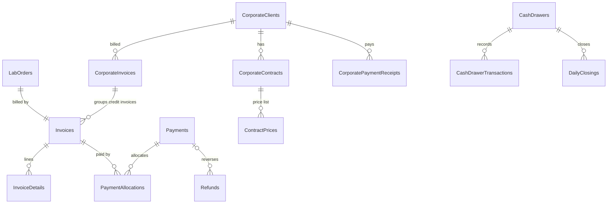

# Data model (ERD)

The complete target model, by schema. **Built** = created in a migration. Other tables are designed here and are created by the migration of the phase that implements them, so every table ships with the code and tests that use it.

## Conventions

| Rule | Detail |
|---|---|
| Keys | `int IDENTITY` for configuration/master data; `bigint IDENTITY` for high-volume transactions (orders, results, payments, stock, audit) |
| Tenant isolation | Every tenant-owned table has `OrganizationId`. Tables that belong to a branch also have `BranchId`. Principal tables expose an alternate key `(OrganizationId, Id)`, and dependents reference it with a **composite foreign key** so a row can never point at another organisation's data. |
| Query isolation | EF global query filters restrict reads to the caller's organisation (and permitted branches). With no signed-in organisation, a filtered query returns nothing (fail closed). |
| Write guard | `SaveChanges` sets `OrganizationId` on new rows from the caller, and rejects rows whose `OrganizationId` differs from the caller's. |
| Money | `decimal(18,2)` |
| Clinical numeric values | `decimal(18,6)`, plus the as-entered text and the configured decimal precision. Values are never rounded in storage. |
| Time | `datetime2(3)` in UTC, columns suffixed `Utc` |
| Audit columns | `CreatedAtUtc`, `CreatedByUserId`, `UpdatedAtUtc`, `UpdatedByUserId`, `RowVersion` (optimistic concurrency) |
| Change history | Entities marked `IAudited` write before/after values to `audit.AuditLogs` in the **same transaction** as the change |
| Soft delete | Only for master data that transactions reference (patients, doctors, tests, items). Transactions are never deleted; they are cancelled or reversed. |
| Bilingual data | `NameEn` / `NameUr` columns (Urdu optional), not machine translation |
| Lists | No comma-separated IDs; always a link table |

## core — organisation, branches, configuration (Phase 2: **built**)

```mermaid
erDiagram
  Organizations ||--o{ Branches : has
  Organizations ||--o{ Departments : has
  Organizations ||--o{ NumberSequences : has
  Branches |o--o{ NumberSequences : "optional per-branch"
  Organizations ||--o{ BusinessSettings : has
  Branches |o--o{ BusinessSettings : "optional override"

  Organizations { int Id PK; nvarchar Code UK; nvarchar NameEn; nvarchar NameUr; bit IsActive }
  Branches { int Id PK; int OrganizationId FK; nvarchar Code "UK per org"; nvarchar NameEn; nvarchar NameUr; bit IsMain; bit IsActive }
  Departments { int Id PK; int OrganizationId FK; nvarchar Code "UK per org"; nvarchar NameEn; nvarchar NameUr; int SortOrder }
  NumberSequences { int Id PK; int OrganizationId FK; int BranchId FK "nullable"; nvarchar SequenceType; nvarchar Prefix; int Padding; nvarchar ResetPolicy; nvarchar CurrentPeriod; bigint NextValue }
  BusinessSettings { int Id PK; int OrganizationId FK; int BranchId FK "nullable"; nvarchar Key; nvarchar Value }
```

## security — users, roles, permissions (Phase 2: **built**; logic in Phase 3)

```mermaid
erDiagram
  Organizations ||--o{ Users : employs
  Organizations ||--o{ Roles : defines
  Permissions ||--o{ RolePermissions : grants
  Roles ||--o{ RolePermissions : has
  Users ||--o{ UserRoles : has
  Roles ||--o{ UserRoles : assigned
  Users ||--o{ UserBranches : "may access"
  Branches ||--o{ UserBranches : "accessible by"
  Users |o--o{ LoginHistory : records

  Users { int Id PK; int OrganizationId FK; nvarchar Username UK; nvarchar PasswordHash; nvarchar SecurityStamp; bit IsActive; bit MustChangePassword; int AccessFailedCount; datetime2 LockoutEndUtc; int DefaultBranchId FK; bit AllBranches; nvarchar PreferredLanguage }
  Roles { int Id PK; int OrganizationId FK; nvarchar Code "UK per org"; nvarchar NameEn; nvarchar NameUr; bit IsSystem }
  Permissions { int Id PK; nvarchar Key UK; nvarchar Module }
  RolePermissions { int RoleId PK; int PermissionId PK; int OrganizationId FK }
  UserRoles { int UserId PK; int RoleId PK; int OrganizationId FK }
  UserBranches { int UserId PK; int BranchId PK; int OrganizationId FK }
  LoginHistory { bigint Id PK; int OrganizationId; int UserId; nvarchar UsernameAttempted; bit Succeeded; nvarchar FailureReason; nvarchar IpAddress }
```

`UserRoles`, `UserBranches` and `RolePermissions` use composite foreign keys `(OrganizationId, UserId)`, `(OrganizationId, RoleId)` and `(OrganizationId, BranchId)`. A user can therefore never be linked to another organisation's role or branch.

## catalog — reference data and test catalog (**built** in Phases 2 and 5)

As built:
- The table is `Tests` (entity `LabTest`).
- Corporate price lists (`TestPrices`) come in Phase 10; Phase 5 stores one standard price per test.
- Option values live in `ParameterOptions`.
- `ReferenceRanges` adds `Source`, `ReplacesRangeId` and retirement fields.


```mermaid
erDiagram
  TestCategories ||--o{ Tests : groups
  Departments ||--o{ Tests : "performed by"
  Tests ||--o{ TestParameters : has
  Units |o--o{ TestParameters : "measured in"
  TestParameters ||--o{ ReferenceRanges : "approved ranges"
  Tests ||--o{ TestSampleRequirements : needs
  SampleTypes ||--o{ TestSampleRequirements : "used by"
  TestPackages ||--o{ PackageTests : contains
  Tests ||--o{ PackageTests : "part of"
  Tests ||--o{ TestBranchAvailability : "offered at"
  Tests ||--o{ TestPrices : priced

  Units { int Id PK; nvarchar Code UK; nvarchar Name }
  SampleTypes { int Id PK; nvarchar Code UK; nvarchar NameEn; nvarchar NameUr; nvarchar Container; nvarchar CapColour }
  Tests { int Id PK; int OrganizationId; nvarchar Code; nvarchar NameEn; nvarchar NameUr; int CategoryId; int DepartmentId; int TurnaroundMinutes; bit IsActive }
  TestParameters { int Id PK; int TestId FK; nvarchar Code; nvarchar NameEn; nvarchar ResultType "Numeric|Text|Qualitative|Structured"; int UnitId; tinyint DecimalPlaces; int SortOrder }
  ReferenceRanges { int Id PK; int ParameterId FK; nvarchar Sex; int AgeFromDays; int AgeToDays; decimal Low; decimal High; decimal CriticalLow; decimal CriticalHigh; nvarchar Status "Draft|Approved|Retired"; int ApprovedByUserId; datetime2 ApprovedAtUtc }
  TestPrices { int Id PK; int TestId FK; int PriceListId FK; decimal Price; date EffectiveFrom }
```

Reference ranges are only used for flagging when `Status = Approved`, and approval requires the `catalog.clinical` permission. **No ranges are seeded.**

## patient (Phase 4: **built**)

- **`Patients`:**
  - Columns: OrganizationId, PatientNo (unique per org), Title, FullName/FullNameUr, GuardianName, Sex, DateOfBirth plus an IsDateOfBirthEstimated flag, the sensitive fields Cnic/Email/Address, Mobile/AltPhone, City, RegisteredBranchId (composite FK), soft delete.
  - Indexes: (Org, PatientNo) unique, (Org, Mobile), (Org, Cnic), (Org, FullName).
- **`Doctors`:** one table for referring and in-house doctors (IsInHouse flag) instead of separate tables. Code is unique per org; PMDC number, specialty and hospital are stored.
- **Simplified:** contacts and addresses are fields on the patient rather than separate tables; their change history is in `audit.AuditLogs`.

## billing (Phases 6 and 10)



- Invoice totals are computed on the server and stored with their components (gross, discount, net, paid, balance).
- Payments are never edited. They are reversed by a refund or reversal row.
- `PaymentAllocations` has a unique `(PaymentId, InvoiceId)` and a check that allocations ≤ payment amount, which prevents double allocation.
- Order and payment creation carry an `IdempotencyKey` (unique) to block duplicate submissions.

## lab (Phases 6–8)

`LabOrders` → `LabOrderDetails` (one per test) → `Samples` (barcode UK) linked to tests through `SampleTests`, with `SampleTracking` (status history), `SampleRejections` and `SampleCollections`. `Worklists` group details by department.

`TestResults` (one per order detail, versioned) → `TestResultValues` (one per parameter, storing the value, the flag and the range used) → `ResultApprovals` (verify/approve steps). `CriticalValueAlerts` record who was notified, when, and the read-back.

## reporting (Phase 9)

`ReportTemplates` + `ReportTemplateTranslations`, `LaboratoryReports` (per order, current version), `ReportVersions` (immutable snapshot of the values printed, plus the amendment reason), `ReportFiles`.

## inventory (Phase 11)

`InventoryItems`, `Suppliers`, `PurchaseReceipts` + `PurchaseReceiptDetails`, `InventoryBatches` (lot, expiry, per branch), `StockTransactions` (append-only ledger; balance = sum), `InventoryAdjustments`, `StockTransfers`, `TestConsumptionProfiles`.

## integration (Phase 14)

`AnalyzerDevices`, `AnalyzerMappings`, `AnalyzerMessages` (raw message + hash for duplicate detection), `AnalyzerResults` (pending manual review), `IntegrationLogs`.

## audit (Phase 2: **built**)

`AuditLogs` (bigint, entity type/id, action, JSON of changed values, user, organisation, branch, time, IP, correlation id). Sensitive columns such as password hashes are never written to it. `BackupLogs` and `SystemLogs` are added in Phases 12–13.
